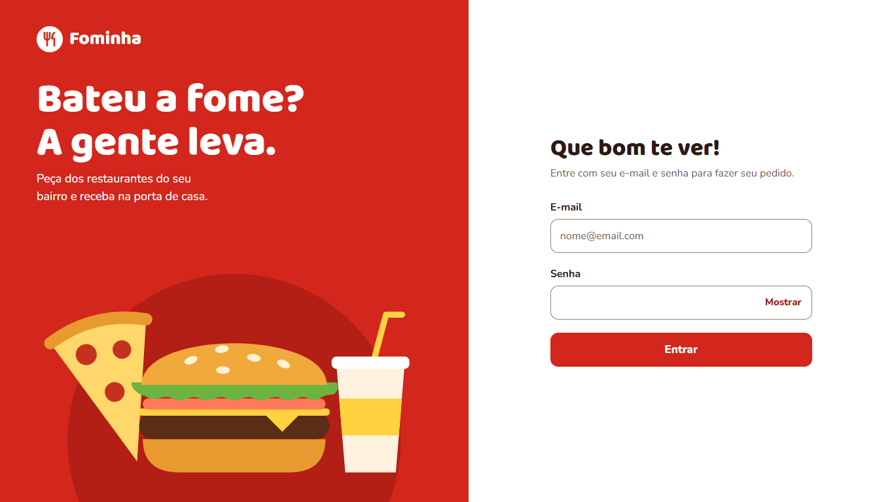
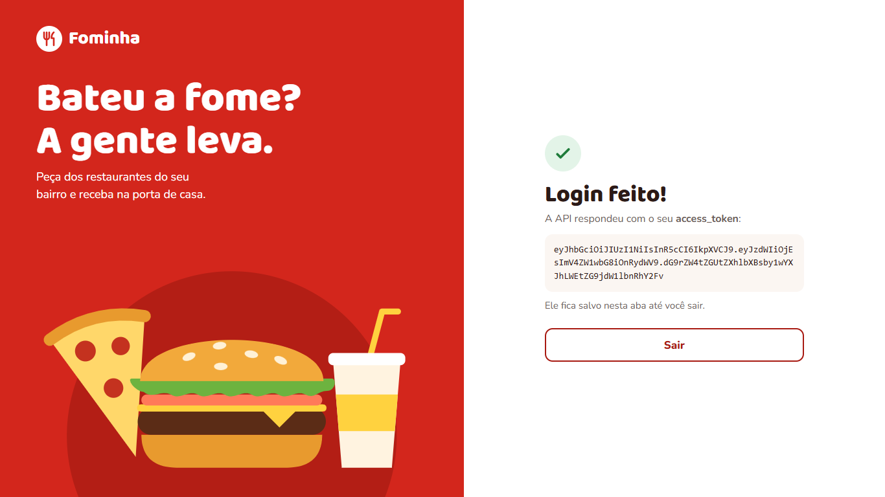
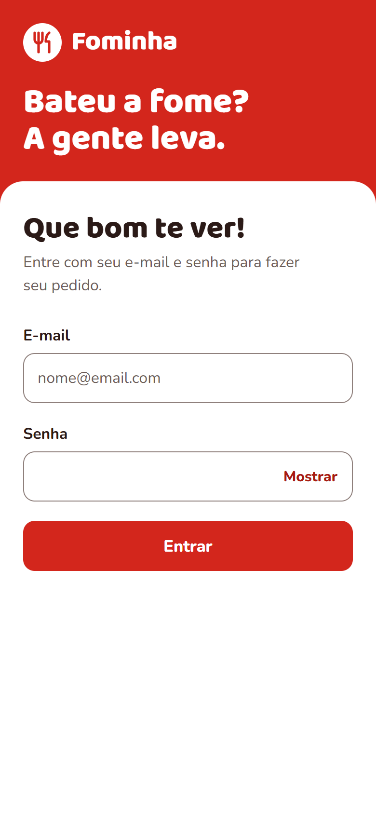

# Fominha: tela de login

Tela de login de um site fictício de pedidos de comida, feita com HTML, CSS e JavaScript puros. A página envia e-mail e senha para uma API e recebe um `access_token`.

Projeto criado como desafio da disciplina **Desenvolvimento de Interfaces de Usuário para Web**.



| Depois do login (token de exemplo) | No celular |
|---|---|
|  |  |

## Como executar

Não é preciso instalar nada, mas é preciso estar com internet para falar com a API.

1. Baixe o projeto com `git clone` ou pelo botão **Code > Download ZIP**.
2. Abra o arquivo `index.html` no navegador.
3. Entre com o usuário de teste público da API:

| E-mail | Senha |
|---|---|
| `john@mail.com` | `changeme` |

> [!WARNING]
> A página usa uma API pública de testes, de terceiros. Não digite nela uma senha que você usa de verdade.

## Funcionalidades

- Login com e-mail e senha, recebendo o `access_token` da API.
- Token exibido na tela e guardado no `sessionStorage` até a pessoa clicar em **Sair**.
- Validação dos campos antes de chamar a API.
- Mensagens de erro em português, explicando o que aconteceu.
- Botão com o aviso “Entrando...” e bloqueado durante o envio, o que evita pedidos duplicados.
- Limite de 15 segundos para a API responder.
- Botão para mostrar ou ocultar a senha.
- Layout com duas colunas no computador e uma no celular.

## Como testar

| Teste | Resultado esperado |
|---|---|
| Entrar com o usuário de teste | “Login feito!” e o `access_token` na tela |
| Clicar em **Entrar** com os campos vazios | “Digite seu e-mail.” e “Digite sua senha.” |
| Digitar `maria` no e-mail e clicar em **Entrar** | “Confira o e-mail. Ele precisa ser como `nome@email.com`.” |
| Usar `john@mail.com` com outra senha | “E-mail ou senha incorretos. Confira os dados e tente de novo.” |
| Tentar entrar sem internet | “Não conseguimos falar com o servidor. Confira sua internet e tente de novo.” |

Para ver a resposta da API, aperte **F12** antes de entrar e abra a aba **Network** (ou **Rede**). O token salvo fica na aba **Application** (ou **Aplicativo**), em **Session Storage**.

## Como o login funciona

A função `pedirToken`, em `src/js/script.js`, faz esta requisição:

```http
POST https://api.escuelajs.co/api/v1/auth/login
Content-Type: application/json

{
  "email": "john@mail.com",
  "password": "changeme"
}
```

Se os dados estiverem certos, a API responde com o status `201`:

```json
{
  "access_token": "eyJhbGciOiJIUzI1NiIs...",
  "refresh_token": "eyJhbGciOiJIUzI1NiIs..."
}
```

A página usa apenas o `access_token`. Se a API responder com outro erro ou sem o token, a pessoa vê a mensagem “Tivemos um problema no servidor. Tente de novo em alguns minutos.”

## Como usar outra API

Todas as mudanças ficam em `src/js/script.js`:

1. Troque o endereço na constante `API_LOGIN_URL`.
2. Se a API pedir outros nomes de campos, como `username`, ajuste o `body` na função `pedirToken`.
3. Se a API responder a uma senha errada com um status diferente de `400` ou `401`, ajuste essa condição na mesma função.

A nova API precisa devolver um JSON com o campo `access_token` e permitir chamadas feitas pelo navegador (CORS).

Na versão em React, as mesmas mudanças ficam em `versao-react/src/api.js`.

## Versão em React

A pasta `versao-react/` tem a mesma tela feita com React e Vite, com os mesmos textos, regras e visual. Ela não abre com dois cliques no arquivo: é preciso ter o [Node.js](https://nodejs.org) instalado e rodar:

```bash
cd versao-react
npm install
npm run dev
```

Depois, abra `http://localhost:5173` no navegador.

## Estrutura do projeto

```text
.
├── index.html          # Estrutura da página
├── README.md
├── docs/               # Imagens deste README
├── src/
│   ├── css/
│   │   └── style.css   # Visual e responsividade
│   └── js/
│       └── script.js   # Validação e chamada à API
└── versao-react/       # A mesma tela feita com React
    ├── index.html
    └── src/
        ├── main.jsx    # Ponto de entrada do React
        ├── App.jsx     # Guarda o token e escolhe a tela
        ├── api.js      # Chamada à API
        ├── style.css
        └── components/
            ├── FormLogin.jsx
            ├── TelaSucesso.jsx
            └── Vitrine.jsx
```

## Princípios de interface aplicados

| Princípio | Como aparece na tela |
|---|---|
| Simplicidade | Só dois campos e um botão principal |
| Hierarquia visual e consistência | Tamanho, peso e cor destacam o título e o botão, e os componentes seguem o mesmo estilo |
| Design responsivo | CSS Grid com duas colunas, que viram uma em telas de até 820 px |
| Feedback visual | Efeito ao passar o mouse, aviso de carregamento, erros junto ao campo e confirmação do login |
| Acessibilidade | Contraste no nível AA da WCAG, ordem lógica na tecla TAB, foco visível, rótulo em todos os campos e erros anunciados a leitores de tela |

## Tecnologias

- **HTML** semântico, com ilustração própria em SVG.
- **CSS** com Grid, Flexbox e media queries.
- **JavaScript** com `fetch`, `async/await` e `sessionStorage`.
- **Fontes** Baloo 2 e Nunito, do Google Fonts.

## Limitações

- O `access_token` aparece na tela só para demonstrar o desafio. Em um site real, a pessoa iria direto para a área de pedidos.
- O `sessionStorage` basta para este desafio, mas qualquer script da página consegue ler o que está guardado nele.
- Não há telas de cadastro nem de recuperação de senha.
- O login depende de uma API pública de terceiros, que pode ficar fora do ar.

## Créditos

- API: [Platzi Fake Store API](https://github.com/PlatziLabs/fake-api-backend) ([documentação dos endpoints](https://api.escuelajs.co/docs)).
- “Fominha” é uma marca fictícia, criada para este projeto, sem relação com o iFood ou outros aplicativos de entrega.
